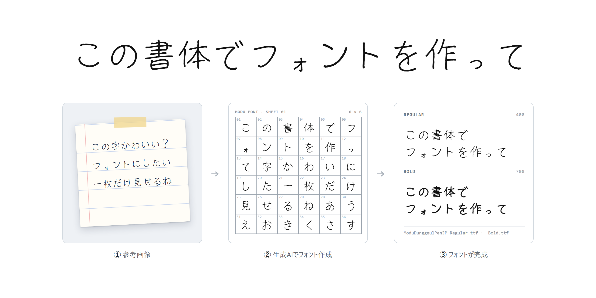

<a href="README.md">English</a> · <a href="README.ko.md">한국어</a> · <b>日本語</b>

# modu-font

参考画像1枚の書体を、実際にインストールして使える TrueType フォントにするエージェントスキル。画像生成モデルが 6×6 のマスに1マス1文字ずつその書体で書き、スキルがマスを切り出して人が確認したあと、輪郭をなぞって Regular・Bold の TTF に組み立てます。日本語(かな・漢字)、韓国語(ハングル)、英字に対応しています。

> スキル本体(インストール方法とファイル)はこのリポジトリに準備中です。

## フォントのダウンロード: モドゥ丸ペン

このスキルで最初に作ったフォント。SIL Open Font License 1.1 で無料です。

**[ModuDunggeulPen-1.100.zip をダウンロード](https://github.com/yskim3271/modu-font-skill/releases/download/fonts-v1.100/ModuDunggeulPen-1.100.zip)**(4 MB)· [リリースノート](https://github.com/yskim3271/modu-font-skill/releases/tag/fonts-v1.100)

| ファイル | 収録文字 |
|---|---|
| `ModuDunggeulPenJP-Regular.ttf` · `-Bold.ttf` | 日本語(かな、常用漢字 2,136 字、縦書き)、英字、数字、記号 |
| `ModuDunggeulPen-Regular.ttf` · `-Bold.ttf` | 韓国語(ハングル)、英字、数字、記号 |

インストール: Windows は `.ttf` を右クリックして **インストール**、macOS はダブルクリックして **フォントをインストール**。

## ライセンス

- フォント: [SIL Open Font License 1.1](fonts/OFL.txt)。自由に使用・改変・再配布できます。フォント単体での販売はできません。
