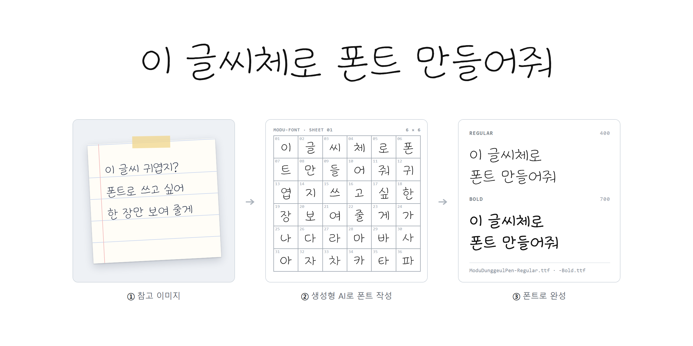

<p align="center"><a href="README.md">English</a> · <b>한국어</b> · <a href="README.ja.md">日本語</a></p>

<p align="center"></p>

# 모두의 폰트 (modu-font)

참고 이미지 한 장의 글씨체를 실제로 설치해 쓰는 TrueType 폰트로 만드는 Claude Code·Codex 용 에이전트 스킬. *"이 글씨체로 폰트 만들어줘"* 라고 하면 이미지 생성 모델이 6×6 칸에 한 칸 한 글자씩 그 글씨체로 쓰고, 스킬이 칸을 잘라 에이전트와 사람이 하나씩 확인한 뒤 윤곽을 따서 보통·굵게 TTF 로 조립한다.

## 폰트 내려받기: 모두의 둥글펜

이 스킬로 처음 만든 폰트. SIL 오픈 폰트 라이선스 1.1 로 무료.

**[ModuDunggeulPen-1.100.zip 내려받기](https://github.com/yskim3271/modu-font-skill/releases/download/fonts-v1.100/ModuDunggeulPen-1.100.zip)** (4 MB) · [릴리스 노트](https://github.com/yskim3271/modu-font-skill/releases/tag/fonts-v1.100)

| 파일 | 들어 있는 글자 |
|---|---|
| `ModuDunggeulPen-Regular.ttf` · `-Bold.ttf` | 한글(KS X 1001 2,350자 중 2,338자), 영문, 숫자, 부호 |
| `ModuDunggeulPenJP-Regular.ttf` · `-Bold.ttf` | 일본어(가나, 상용한자 2,136자, 세로쓰기), 영문, 숫자, 부호 |

설치: Windows 는 `.ttf` 파일을 오른쪽 클릭해 **설치**, macOS 는 두 번 클릭해 **서체 설치**.

## 만드는 과정

| | 단계 | 명령 |
|---|---|---|
| ① | 참고 이미지(마음에 드는 글씨 사진, 또는 AI 시안 4개 중 하나)와 글자 수를 정한다 | `init` (`drafts` → `pick`) |
| ② | 장마다 묶음을 만든다: 견본, 시트 형식, 그 장의 36자를 적은 프롬프트 | `jobs` |
| ③ | 이미지 모델이 시트를 쓴다. **첫 장은 사용자와 확인한 뒤에** 나머지를 그리고, 그 장이 다음 장들의 형식 참조가 된다 | OpenAI 키 또는 에이전트의 이미지 도구 |
| ④ | 하늘색 격자를 찾아 36칸을 자르고 검토 페이지를 만든다 | `cut` |
| ⑤ | 에이전트가 칸마다 써야 할 글자와 대조해 틀린 칸을 제안하고, 사용자가 페이지에서 확인한다. 틀린 글자는 다시 쓰기 장으로 | `review` · `redo` |
| ⑥ | 잉크를 윤곽으로 따서 폰트를 조립하고, 같은 그림으로 굵은 판을 만든다 | `glyphs` → `build_font.py` → `bold` |

모델은 드문 글자에서 틀린다(한글 2,350자 첫 시도 1,872칸 중 63칸). 그래서 검수 단계는 빼지 않는다.

## 모드

| 모드 | 글자 | 문서 |
|---|---|---|
| 한국어(기본) | 한글 500자 또는 KS X 1001 2,350자 전부 + 부호·채팅 낱자모·숫자 | [korean.md](skills/modu-font/references/korean.md) |
| 일본어 | 가나 + 한자 목록(상용한자 2,136자, JIS 1·2수준), 세로쓰기 모양은 조립 때 저절로 | [japanese.md](skills/modu-font/references/japanese.md) |
| 영문 더하기 | 대소문자 + ASCII 부호를 안내선 있는 3장에. 조립 때 기준선 맞춤·옆 여백·커닝. 한국어·일본어 폰트 모두 | [latin.md](skills/modu-font/references/latin.md) |

## 그리는 방법과 비용

그림은 **OpenAI API 키**(`hf.mjs openai`) 또는 **에이전트의 이미지 도구**(Codex 내장 도구, 이미지 MCP 서버)로 그린다. 어느 쪽이든 견적을 먼저 보여 주고, 사용자 승인과 상한을 `ledger.json` 에 적고, 상한에서 멈춘다.

GPT Image 2.6 · 2K 실측, 장당 약 $0.42:

| 목표 | 장 | 비용 |
|---|---|---|
| 한글 500자 + 부호 | 15 | 약 $6 |
| 한글 2,350자 전부 + 부호 | 67 + 다시 쓰기 몇 장 | 약 $30 |
| 일본어 상용한자 2,136자 + 가나 + 부호 | 69(실측) | $30.22 |
| 영문 더하기 | 3(실측, 다시 쓰기 없음) | $1.29 |

## 설치

필요한 것: Node 18.17 이상, Python 3.

**Claude Code 플러그인**
```
/plugin marketplace add yskim3271/modu-font-skill
/plugin install modu-font@modu-font-skill
```

**손으로**: `skills/modu-font` 폴더를 `~/.claude/skills/modu-font`(Claude Code) 또는 `~/.agents/skills/modu-font`(Codex)에 복사한다.

그다음 스킬 폴더에서 한 번:
```sh
npm install                      # sharp
pip install -r requirements.txt  # fontTools
```

에이전트에게 *"이 이미지 글씨체로 폰트 만들어줘"* 라고 하면 된다. 스킬이 먼저 몇 가지(견본, 글자 수, 그리는 방법, 폰트 이름, 영문 여부)를 묻고, 돈이 드는 일은 승인 전에 돌리지 않는다. 전체 규칙: [SKILL.md](skills/modu-font/SKILL.md) · 명령: [commands.md](skills/modu-font/references/commands.md).

## 라이선스

- 스킬 코드: [MIT](LICENSE)
- 폰트: [SIL 오픈 폰트 라이선스 1.1](fonts/OFL.txt). 자유롭게 쓰고 고치고 함께 배포할 수 있다. 폰트 자체만 따로 팔 수는 없다.
- 직접 만든 폰트의 라이선스는 만든 사람이 정한다. 다만 쓴 이미지 서비스의 출력물 상업 이용 약관은 확인한다.
