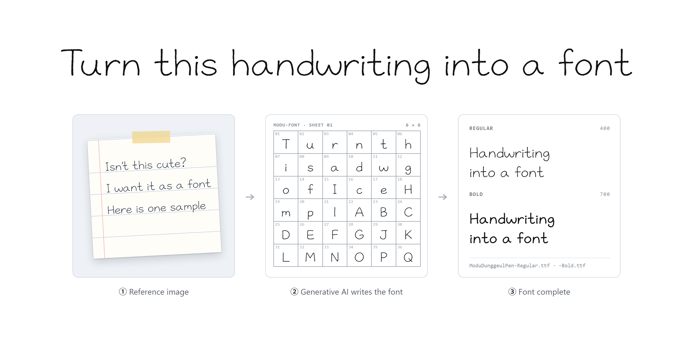

<p align="center"><b>English</b> · <a href="README.ko.md">한국어</a> · <a href="README.ja.md">日本語</a></p>

<p align="center"></p>

# modu-font

An agent skill for Claude Code and Codex that turns the lettering style in one reference image into a real, installable TrueType font: handwriting, or printed type such as a Myeongjo or Gothic. Ask *"turn this handwriting into a font"* or *"make a Myeongjo font in this style"*: an image model writes every character in that style, cell by cell, on gridded sheets (Korean: 14×14 or 12×12, picked from the reference's stroke weight; Japanese and Latin: 6×6); the skill checks each sheet's grid, cuts the cells, has the agent and you check each one, traces the outlines and builds Regular and Bold TTFs.

## Download the fonts: Modu Dunggeul Pen

The first fonts made with this skill, free under the SIL Open Font License 1.1.

**[Download ModuDunggeulPen-1.100.zip](https://github.com/yskim3271/modu-font-skill/releases/download/fonts-v1.100/ModuDunggeulPen-1.100.zip)** (4 MB) · [Release notes](https://github.com/yskim3271/modu-font-skill/releases/tag/fonts-v1.100)

| File | Covers |
|---|---|
| `ModuDunggeulPen-Regular.ttf` · `-Bold.ttf` | Korean (2,338 of the 2,350 KS X 1001 Hangul syllables), Latin, digits, punctuation |
| `ModuDunggeulPenJP-Regular.ttf` · `-Bold.ttf` | Japanese (kana, the 2,136 Joyo kanji, vertical forms), Latin, digits, punctuation |

Install: on Windows, right-click the `.ttf` files and choose **Install**; on macOS, double-click and choose **Install Font**.

## How it works

| | Step | Command |
|---|---|---|
| ① | Pick the reference image (a photo of lettering you like, or one of four AI drafts) and the character set. For Korean the skill measures the stroke weight and picks the grid (thin: 14×14, thick: 12×12) | `init` (`drafts` → `pick`) |
| ② | Bundle each sheet: the reference, the sheet format and a prompt listing its characters (196 on a 14×14 sheet) | `jobs` |
| ③ | An image model writes the sheet. **The first sheet is checked with you before the rest are drawn**, and it becomes the format reference for the others. For Korean the first sheet must also pass the sheet check; if it fails, it is redrawn once at the same grid, then the grid is lowered one step | OpenAI key or the agent's image tool |
| ④ | Find the light-blue grid, cut the cells and make a review page. For Korean the sheet check runs first (line count, row drift, one character per cell), cells are cut along the found lines, and characters in unusable rows go on correction sheets | `cut` |
| ⑤ | The agent compares every cell with the character it should be and proposes errors; you confirm them on the page. Wrong characters go on correction sheets | `review` · `redo` |
| ⑥ | Trace the ink into outlines and build the font, then a Bold weight from the same drawings | `glyphs` → `build_font.py` → `bold` |

The model does make mistakes on rare characters (6×6, 2,350 Korean characters: 63 of 1,872 cells wrong on the first try; 14×14, one 500-character font: 3 of 500 wrong on the first try), so the review step is never skipped.

## Modes

| Mode | Characters | Docs |
|---|---|---|
| Korean (default) | Hangul, 500 or all 2,350 of KS X 1001, plus punctuation, chat jamo and digits | [korean.md](skills/modu-font/references/korean.md) |
| Japanese | kana + a kanji list (the 2,136 Joyo kanji, or JIS level 1/2), vertical forms built automatically | [japanese.md](skills/modu-font/references/japanese.md) |
| Add Latin | A–Z, a–z and ASCII punctuation on 3 sheets with guide lines; baseline alignment, spacing and kerning at build time. Works on Korean and Japanese fonts | [latin.md](skills/modu-font/references/latin.md) |

## Drawing and cost

Images are generated with either an **OpenAI API key** (`hf.mjs openai`) or **the agent's own image tool** (Codex's built-in tool, an image MCP server). Either way the skill shows an estimate first, records your approval in `ledger.json` before drawing, and logs what each sheet cost. Redraws, correction sheets and a lower grid are announced with their price; after a correction sheet is made or the grid changes, drawing stops until you approve again.

Measured with GPT Image 2.6 at 2K, about $0.42 per sheet:

| Target | Sheets | Cost |
|---|---|---|
| Korean, 500 characters + punctuation (14×14, thin strokes) | 4 + corrections | about $1.7 + corrections (measured: 4 sheets $1.70 + corrections) |
| Korean, 500 characters + punctuation (12×12, thick strokes) | 5 + corrections | about $2.1 + corrections |
| Korean, all 2,350 + punctuation (14×14) | 13 + corrections | about $5.5 + corrections |
| Korean, all 2,350 + punctuation (12×12) | 18 + corrections | about $7.6 + corrections |
| Japanese, 2,136 Joyo kanji + kana + punctuation | 69 (measured) | $30.22 |
| Add Latin | 3 (measured, no corrections) | $1.29 |

## Install

Requirements: Node 18.17+ and Python 3.

**Claude Code plugin**
```
/plugin marketplace add yskim3271/modu-font-skill
/plugin install modu-font@modu-font-skill
```

**By hand**: copy `skills/modu-font` to `~/.claude/skills/modu-font` (Claude Code) or `~/.agents/skills/modu-font` (Codex).

Then, once, inside the skill folder (for the plugin it is `~/.claude/plugins/cache/modu-font-skill/modu-font/<version>/skills/modu-font`; if you skip this, the skill stops with a message and your agent can run it there after asking you):
```sh
npm install                      # sharp
pip install -r requirements.txt  # fontTools
```

Then ask your agent: *"turn the handwriting in this image into a font"* (or *"the lettering in this image"* for printed type). The skill asks a few short questions first (handwriting or printed type, reference, character count, how to draw, font name, whether to add Latin), and nothing that costs money runs before you approve it. Full rules: [SKILL.md](skills/modu-font/SKILL.md) · commands: [commands.md](skills/modu-font/references/commands.md). The skill's own instructions and references are written in Korean; agents follow them in any language.

## License

- Skill code: [MIT](LICENSE)
- Fonts: [SIL Open Font License 1.1](fonts/OFL.txt). Use, modify and redistribute them freely; just don't sell the fonts by themselves.
- Fonts you make are yours to license, but check the terms of the image service you used for commercial use of its output.
