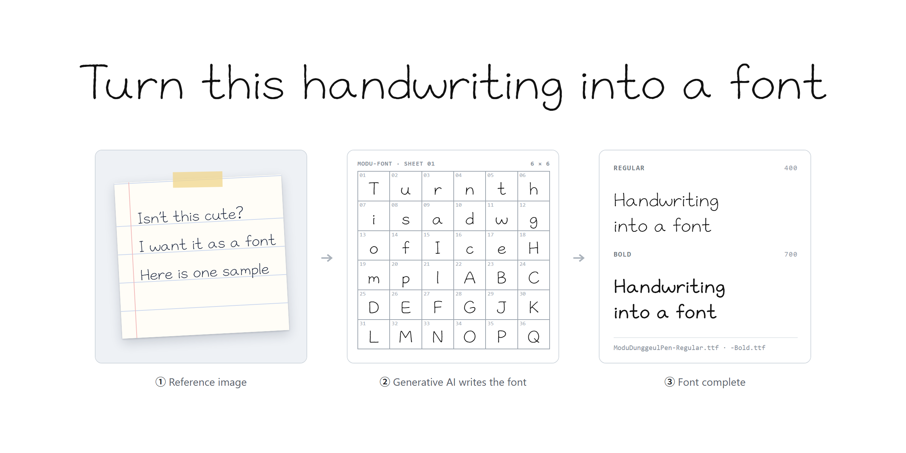

<b>English</b> · <a href="README.ko.md">한국어</a> · <a href="README.ja.md">日本語</a>

# modu-font

An agent skill that turns the handwriting in one reference image into a real, installable TrueType font. An image model writes the characters cell by cell on 6×6 sheets in that hand; the skill cuts the cells, has a person check them, traces the outlines and builds Regular and Bold TTFs. Korean (Hangul), Japanese (kana + kanji) and Latin letters are supported.

> The skill itself (install guide and files) is being prepared for this repository.

## Download the fonts: Modu Dunggeul Pen

The first fonts made with this skill, free under the SIL Open Font License 1.1.

**[Download ModuDunggeulPen-1.100.zip](https://github.com/yskim3271/modu-font-skill/releases/download/fonts-v1.100/ModuDunggeulPen-1.100.zip)** (4 MB) · [Release notes](https://github.com/yskim3271/modu-font-skill/releases/tag/fonts-v1.100)

| File | Covers |
|---|---|
| `ModuDunggeulPen-Regular.ttf` · `-Bold.ttf` | Korean (2,338 of the 2,350 KS X 1001 Hangul syllables), Latin, digits, punctuation |
| `ModuDunggeulPenJP-Regular.ttf` · `-Bold.ttf` | Japanese (kana, the 2,136 Joyo kanji, vertical forms), Latin, digits, punctuation |

Install: on Windows, right-click the `.ttf` files and choose **Install**; on macOS, double-click and choose **Install Font**.

## License

- Fonts: [SIL Open Font License 1.1](fonts/OFL.txt). Use, modify and redistribute them freely; just don't sell the fonts by themselves.
